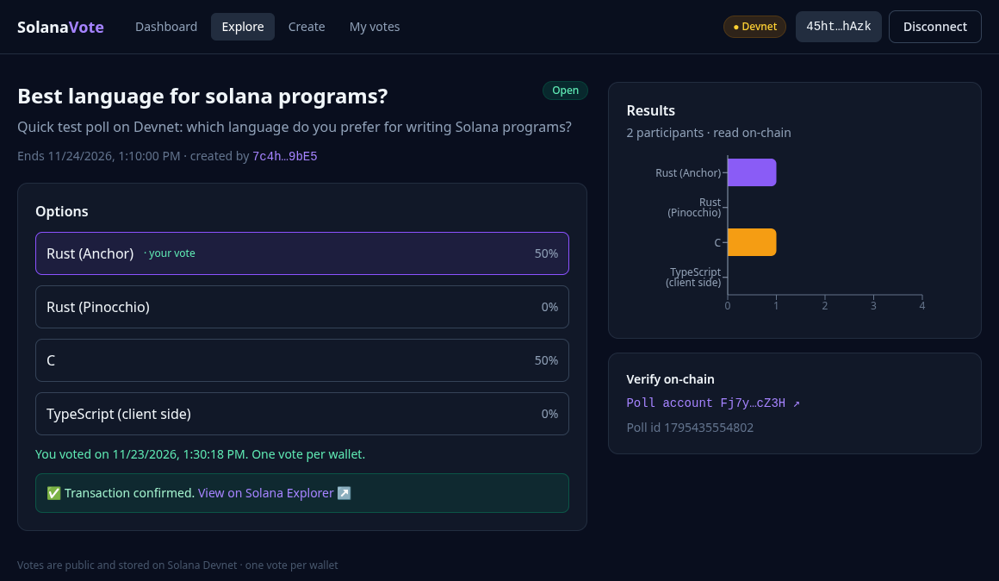
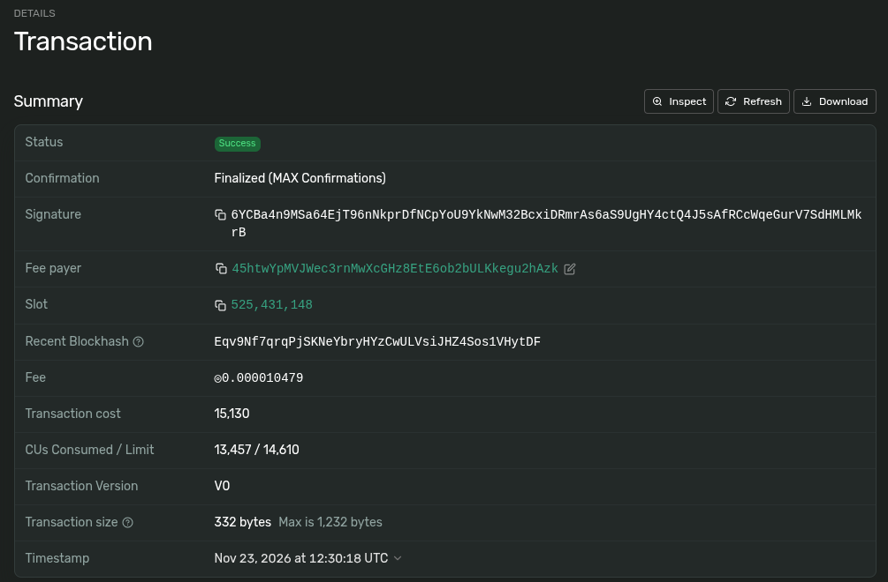

# SolanaVote — Decentralized Voting Platform

A transparent, on-chain voting dApp: a **Rust + Anchor** program deployed on **Solana Devnet** and a
**React + TypeScript** frontend.
An administrator creates a poll with several options and a deadline; any wallet can vote **once per poll**;
results are stored on-chain and can be read by anyone without trusting a central server.

| | |
|---|---|
| **Program ID** | [`6oDhsVkgdj2H7eoR9qQdVAXNm2oCszVWgYQfF5vg6SG7`](https://explorer.solana.com/address/6oDhsVkgdj2H7eoR9qQdVAXNm2oCszVWgYQfF5vg6SG7?cluster=devnet) |
| **Network** | Solana Devnet |
| **Framework** | Anchor 1.2.2 · Solana CLI 4.1.2 · Rust 1.89 |
| **IDL** | Published on-chain (Program Metadata) |
| **Tests** | 18 passing (LiteSVM) |
| **security.txt** | Embedded in the program ([SECURITY.md](SECURITY.md)) |
| **Frontend** | React 19 · TypeScript · Vite · Tailwind CSS · `@solana/kit` · Wallet Standard |



*A poll on Devnet after two different wallets voted: each wallet sees its own vote, results are read
directly from the `Poll` account, and every transaction links to Solana Explorer.*

---

## Table of contents

1. [Features](#features)
2. [Architecture](#architecture)
3. [Accounts (PDAs)](#accounts-pdas)
4. [Instructions](#instructions)
5. [Security rules](#security-rules)
6. [Design choices and limitations](#design-choices-and-limitations)
7. [Project structure](#project-structure)
8. [Getting started](#getting-started)
9. [Frontend](#frontend)
10. [Tests](#tests)
11. [Roadmap](#roadmap)

---

## Features

| Feature | Status |
|---|---|
| Create a poll (title, description, 2–10 options, deadline) | ✅ |
| Vote on-chain, signed by the voter's wallet | ✅ |
| One vote per wallet and per poll | ✅ |
| Per-option results stored on-chain | ✅ |
| Early closing, restricted to the poll creator | ✅ |
| Automatic refusal of votes after the deadline | ✅ |
| Deployment on Devnet | ✅ |
| `security.txt` embedded in the program | ✅ |
| React frontend: wallet connection, create, vote, results chart, voting history | ✅ tested end-to-end with Phantom on Devnet |

---

## Architecture

```
┌──────────────────────────────┐
│  Frontend (React + TS)       │  Dashboard · Polls · Vote · Results
└──────────────┬───────────────┘
               │ builds transactions from the IDL
┌──────────────▼───────────────┐
│  Wallet (Phantom, Solflare…) │  signs the transactions
└──────────────┬───────────────┘
               │
┌──────────────▼───────────────┐
│  solana_vote program         │  create_poll · vote · close_poll
│  (Rust + Anchor)             │  validates accounts, rules, arithmetic
└──────────────┬───────────────┘
               │
┌──────────────▼───────────────┐
│  Solana Devnet               │  Poll accounts · VoteRecord accounts
└──────────────────────────────┘
```

No backend is needed: every poll and every vote lives in an on-chain account owned by the program.

---

## Accounts (PDAs)

A **PDA** (Program Derived Address) is an address computed from *seeds* and the program ID.
The same seeds always give the same address, so a client can find an account without storing it,
and only the program can sign for it.

### `Poll` — a poll

Seeds: `["poll", authority, poll_id (u64, little-endian)]`

| Field | Type | Description |
|---|---|---|
| `authority` | `Pubkey` | Creator of the poll — the only wallet allowed to close it |
| `poll_id` | `u64` | Identifier chosen by the creator |
| `title` | `String` (≤ 64 bytes) | Title |
| `description` | `String` (≤ 256 bytes) | Description |
| `options` | `Vec<String>` (2–10 × ≤ 32 bytes) | Proposals |
| `vote_counts` | `Vec<u64>` | `vote_counts[i]` = votes for `options[i]` |
| `end_time` | `i64` | Unix timestamp after which votes are refused |
| `total_votes` | `u64` | Total number of votes |
| `is_active` | `bool` | `false` once closed by the authority |
| `bump` | `u8` | Stored PDA bump |

Size: **842 bytes** → rent-exempt deposit ≈ **0.0049 SOL**, paid by the creator.

### `VoteRecord` — proof of a vote

Seeds: `["vote", poll, voter]`

| Field | Type | Description |
|---|---|---|
| `poll` | `Pubkey` | Poll address |
| `voter` | `Pubkey` | Voter's wallet |
| `selected_option` | `u8` | Index of the chosen option |
| `voted_at` | `i64` | Unix timestamp of the vote |
| `bump` | `u8` | Stored PDA bump |

Size: **82 bytes** → rent-exempt deposit ≈ **0.0011 SOL**, paid by the voter.

Because the address depends only on the pair *(poll, voter)*, a wallet can create this account **only once
per poll**: a second vote targets the same address and is rejected by the runtime.

---

## Instructions

### `create_poll(poll_id, title, description, options, end_time)`

| Account | Constraint |
|---|---|
| `authority` | `Signer`, `mut` (pays the rent) |
| `poll` | `init`, PDA `["poll", authority, poll_id]` |
| `system_program` | — |

Checks: title not empty and ≤ 64 bytes · description ≤ 256 bytes · 2 to 10 options · each option not empty
and ≤ 32 bytes · `end_time` in the future. The poll starts **active** with all counters at 0.

### `vote(option_index)`

| Account | Constraint |
|---|---|
| `voter` | `Signer`, `mut` (pays the rent of the record) |
| `poll` | `mut`, canonical PDA (`seeds` + stored `bump`) |
| `vote_record` | `init`, PDA `["vote", poll, voter]` |
| `system_program` | — |

Checks: poll is active · current time `< end_time` · `option_index` exists. Then
`vote_counts[option_index]` and `total_votes` are incremented with `checked_add`.

### `close_poll()`

| Account | Constraint |
|---|---|
| `authority` | `Signer` |
| `poll` | `mut`, canonical PDA, `has_one = authority` |

Checks: caller is the poll authority · poll not already closed. Sets `is_active = false`.
Results stay on-chain and readable.

### Reading data

No instruction is needed to read a poll: clients fetch and decode the `Poll` account directly
(e.g. with the Anchor client and the IDL), or list all polls / all votes of a wallet with `getProgramAccounts`.

### Errors

| Error | When |
|---|---|
| `TitleEmpty` / `TitleTooLong` | Invalid title |
| `DescriptionTooLong` | Description over 256 bytes |
| `NotEnoughOptions` / `TooManyOptions` | Fewer than 2 or more than 10 options |
| `OptionEmpty` / `OptionTooLong` | Invalid option text |
| `EndTimeInPast` | Deadline not in the future |
| `PollClosed` | Voting on, or closing, a closed poll |
| `PollEnded` | Voting at or after `end_time` |
| `InvalidOption` | `option_index` out of range |
| `Unauthorized` | Closing a poll you did not create |
| `Overflow` | A counter would overflow |

---

## Security rules

| Rule | How it is enforced |
|---|---|
| Only the creator can close a poll | `has_one = authority` + `Signer` |
| One vote per wallet per poll | `VoteRecord` PDA `["vote", poll, voter]` created with `init` |
| Votes only on an open poll | `require!(poll.is_active)` |
| No vote after the deadline | `require!(now < poll.end_time)` using the on-chain `Clock` |
| Valid option index | `require!(index < options.len())` |
| No numeric overflow | `checked_add` on counters, and `overflow-checks = true` in release |
| Accounts bound to the right poll/voter | `Account<Poll>` (owner + discriminator) and PDA `seeds` checks |
| Input sizes bounded | Explicit length checks matching `#[max_len]` |

---

## Design choices and limitations

- **No global poll counter.** The creator chooses `poll_id` (for example the current timestamp).
  The PDA already prevents duplicates, so a `PollCounter` account and an `initialize_counter`
  instruction would add complexity without adding security.
- **Per-option counters on-chain.** `vote_counts` makes results readable in a single account read,
  instead of scanning every `VoteRecord`.
- **No `update_poll`.** Editing a poll is intentionally left out of the MVP: a poll's content is
  immutable once created, which removes a whole class of manipulation.
- **One vote per wallet ≠ one vote per person.** Anyone can create several wallets (Sybil attack).
  Guaranteeing one vote per person would need an extra eligibility layer (allowlist, token gating,
  identity proof).
- **Votes are public.** Voter addresses and choices are visible on-chain. SolanaVote is a
  *transparent* voting platform, not a secret-ballot election system.
- **String limits are in bytes.** Accented characters or emojis use more than one byte.

---

## Project structure

```
solana-vote/
├── programs/solana-vote/
│   ├── src/
│   │   ├── lib.rs                  # program entry point (instruction list)
│   │   ├── constants.rs            # PDA seeds and size limits
│   │   ├── error.rs                # custom errors
│   │   ├── state.rs                # Poll and VoteRecord accounts
│   │   ├── instructions.rs
│   │   └── instructions/
│   │       ├── create_poll.rs
│   │       ├── vote.rs
│   │       └── close_poll.rs
│   └── tests/
│       ├── common/mod.rs           # shared test helpers
│       ├── test_create_poll.rs
│       ├── test_vote.rs
│       └── test_close_poll.rs
├── app/                            # React frontend
│   ├── index.html
│   ├── vite.config.ts
│   ├── scripts/generate-client.mjs # IDL -> TypeScript client (Codama)
│   └── src/
│       ├── client.ts               # Kit client: RPC + Wallet Standard signer
│       ├── hooks.ts                # data fetching (SWR) + transaction sending
│       ├── lib/                    # poll queries, error messages, helpers
│       ├── components/             # wallet button, poll card, results chart…
│       ├── pages/                  # Dashboard, Explore, Create, Poll, My votes
│       └── generated/              # generated program client (do not edit)
├── SECURITY.md
├── Anchor.toml
└── Cargo.toml
```

---

## Getting started

### Prerequisites

| Tool | Version |
|---|---|
| Rust | via `rustup` (the project pins 1.89 in `rust-toolchain.toml`) |
| Solana CLI (Agave) | 4.1.2 |
| Anchor CLI | 1.2.2 (via `avm`) |

### Build and test

```bash
anchor build      # compiles the program and generates the IDL in target/idl/
anchor test       # runs the 18 LiteSVM tests (local, no network needed)
```

### Deploy to Devnet

```bash
solana config set --url devnet
solana airdrop 2                     # or https://faucet.solana.com
anchor program deploy --provider.cluster devnet
solana program show 6oDhsVkgdj2H7eoR9qQdVAXNm2oCszVWgYQfF5vg6SG7
```

> **Notes on `anchor build`**
> - With Anchor 1.x, `anchor build` also compiles the crate in `test` profile and runs it to generate the IDL —
>   the `Running tests/...` lines in the output are expected.
> - A warning such as *"The latest cargo build-sbf platform-tools (v1.58) is not installed"* is harmless;
>   install them with `cargo build-sbf --tools-version v1.58 --install-only` to silence it.

Redeploying with the same program keypair (`target/deploy/solana_vote-keypair.json`, never committed)
upgrades the program **at the same address**.

---

### Example: a vote on Devnet

A real `vote` transaction sent from the frontend by a second wallet
([view on Solana Explorer](https://explorer.solana.com/tx/6YCBa4n9MSa64EjT96nNkprDfNCpYoU9YkNwM32BcxiDRmrAs6aS9UgHY4ctQ4J5sAfRCcWqeGurV7SdHMLMkrB?cluster=devnet)):
finalized, ~13.5k compute units, 332 bytes, fee ≈ 0.00001 SOL (plus ≈ 0.0011 SOL of rent for the `VoteRecord`).



---

## Frontend

A single-page app that talks directly to Solana Devnet — no backend.

### Pages

| Page | What it does |
|---|---|
| **Dashboard** | Number of polls, open polls, total votes, latest polls |
| **Explore** | All polls with an *Open / Ended / Closed* filter |
| **Create** | Form (title, description, 2–10 options, end date) with the same size limits as the program |
| **Poll** | Pick an option and vote, see your own vote, live results chart, *Close poll* for the creator (while the poll is open), Explorer links |
| **My votes** | Voting history of the connected wallet |

Every transaction shows a pending state, then a link to Solana Explorer on success, or a readable error
(already voted, poll closed, voting over, rejected in the wallet, not enough SOL…).
A permanent **Devnet** badge is displayed in the header.

### How it works

| Concern | Implementation |
|---|---|
| Wallet connection | `@solana/kit-plugin-wallet` (Wallet Standard): Phantom, Solflare, Backpack… |
| RPC + transaction sending | One `@solana/kit` client (`createClient().use(walletSigner(...)).use(solanaRpc(...))`) |
| Program client | Generated from the Anchor IDL with **Codama** (`npm run codama`): typed instruction builders, account decoders and PDA helpers |
| Listing polls | `getProgramAccounts` filtered on the `Poll` discriminator (first 8 bytes) |
| Listing a wallet's votes | `getProgramAccounts` filtered on the `VoteRecord` discriminator + the voter address (offset 40) |
| Caching / refresh | SWR, refreshed every 15 s and after each transaction |
| Poll status | Computed client-side from `is_active` and `end_time` with a 1 s clock (`useNow`), so a poll switches from *Open* to *Ended* exactly at its deadline without a reload |
| Charts | Recharts |

### Run it

```bash
cd app
npm install
npm run dev          # http://localhost:5173
```

The frontend lives in `app/`: run npm commands from there (or use `npm --prefix app run dev` from the repo root).

Set your wallet to **Devnet** (in Phantom: *Settings → Developer settings → Testnet mode → Solana Devnet*)
and fund it from https://faucet.solana.com.

To use another RPC endpoint, create `app/.env.local` with `VITE_RPC_URL=https://...`.

After changing the program, regenerate the client:

```bash
anchor build
cd app && npm run codama
```

---

## Tests

Tests run against an in-memory Solana VM ([LiteSVM](https://github.com/LiteSVM/litesvm)).
The on-chain clock can be moved forward to test deadlines without waiting.

| Scenario | Expected | Test |
|---|---|---|
| Create a valid poll | Success | `create_valid_poll` |
| Reuse the same `poll_id` | Refused | `same_id_cannot_be_created_twice` |
| Empty title | `TitleEmpty` | `reject_empty_title` |
| Title too long | `TitleTooLong` | `reject_title_too_long` |
| Fewer than 2 options | `NotEnoughOptions` | `reject_not_enough_options` |
| More than 10 options | `TooManyOptions` | `reject_too_many_options` |
| Empty option | `OptionEmpty` | `reject_empty_option` |
| Deadline in the past | `EndTimeInPast` | `reject_end_time_in_past` |
| Vote on an open poll | Success, counters updated | `vote_is_counted_and_recorded` |
| Several voters | Correct totals | `several_voters_are_counted` |
| Same wallet votes twice | Refused, counters unchanged | `same_wallet_cannot_vote_twice` |
| Non-existent option | `InvalidOption` | `reject_invalid_option` |
| Vote at the deadline | `PollEnded` | `reject_vote_after_end_time` |
| Vote one second before the deadline | Success | `vote_just_before_end_time_is_accepted` |
| Creator closes the poll | Success, results kept | `authority_can_close_and_results_stay_readable` |
| Vote on a closed poll | `PollClosed` | `reject_vote_on_closed_poll` |
| Another wallet closes the poll | `Unauthorized` | `reject_close_by_another_wallet` |
| Close twice | `PollClosed` | `reject_closing_twice` |

```
test result: ok. 8 passed  (create_poll)
test result: ok. 6 passed  (vote)
test result: ok. 4 passed  (close_poll)
```

---

## Roadmap

- [x] Anchor program: `create_poll`, `vote`, `close_poll`
- [x] Automated tests for success and failure cases
- [x] Deployment on Devnet with on-chain IDL
- [x] `security.txt` embedded in the program
- [x] React + TypeScript frontend: wallet connection, poll list, create, vote, results chart, voting history
- [x] End-to-end test of the frontend with a wallet on Devnet (create, vote, one-vote-per-wallet, automatic end)
- [x] Demo transactions on Devnet with several wallets
- [x] Screenshots
- [ ] Verified build (`solana-verify`, requires a public repository)
